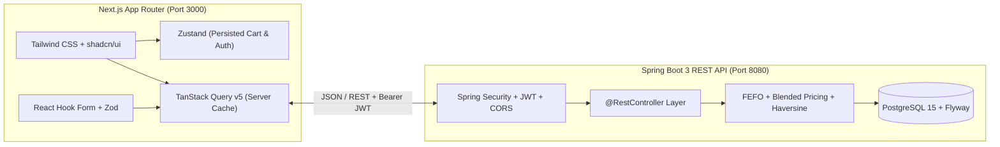

# Product Requirements Document (PRD): Lezzat Frozen Food — Headless E-Commerce (B2C, B2B & Admin)

> [!NOTE]
> Dokumen ini disusun berdasarkan hasil audit langsung terhadap kode *backend* Spring Boot **Lezzat Frozen Food** saat ini ([`V1__init_schema.sql`](file:///home/reno/frozenfood-api/src/main/resources/db/migration/V1__init_schema.sql) dan seluruh modul di [`com.lezzat.b2b2c.frozenfood`](file:///home/reno/frozenfood-api/src/main/java/com/lezzat/b2b2c/frozenfood/FrozenFoodApplication.java)). **Backend sudah 100% menggunakan `@RestController` dan Stateless JWT**, serta telah dilengkapi 4 penyesuaian kesiapan integrasi untuk Next.js.

---

## 1. Visi & Tujuan Produk

Membangun antarmuka *Headless E-Commerce* modern untuk **Lezzat Frozen Food** yang memisahkan pengalaman berbelanja antara pelanggan ritel (**B2C**), mitra grosir (**B2B**), dan pengelola gudang/keuangan (**ADMIN**) di atas satu basis kode Next.js (Multi-Repo) yang terhubung ke Spring Boot REST API.

### Nilai Bisnis Utama (*Core Business Logic*)
1. **FEFO Inventory Management (*First Expired, First Out*):** Pemotongan stok otomatis dari *batch* dengan tanggal kedaluwarsa paling dekat ([`FefoInventoryService.java`](file:///home/reno/frozenfood-api/src/main/java/com/lezzat/b2b2c/frozenfood/service/core/FefoInventoryService.java)).
2. **B2B Blended & Auto-Tiering Pricing:** Perhitungan harga grosir dinamis yang menggabungkan diskon kuantitas (*tiering*), diskon reguler B2B (8%), dan harga cuci gudang (*clearance* 50% untuk batch H-7 *expired*) menjadi satu harga satuan rata-rata (*blended unit price*) ([`TieringPriceService.java`](file:///home/reno/frozenfood-api/src/main/java/com/lezzat/b2b2c/frozenfood/service/TieringPriceService.java)).
3. **Smart Radius Delivery (Haversine ≤ 15 km):** Validasi jangkauan pengiriman produk beku secara geografis demi menjaga kualitas rantai dingin (*cold chain*) ([`SmartDeliveryService.java`](file:///home/reno/frozenfood-api/src/main/java/com/lezzat/b2b2c/frozenfood/service/core/SmartDeliveryService.java)).

---

## 2. Arsitektur & Tech Stack Optimal



| Layer | Teknologi Pilihan | Alasan Optimalisasi |
| :--- | :--- | :--- |
| **Core Framework** | **Next.js (App Router) + TypeScript** | Pemisahan rute `(shop)`, `(b2b)`, dan `(admin)` yang bersih dengan *type-safety* ketat sesuai DTO Java. |
| **UI & Styling** | **Tailwind CSS + shadcn/ui + Lucide Icons** | Komponen siap pakai untuk *Drawer Cart*, *Data Table* inventori FEFO, *Badge* status pengiriman, dan *Dialog* konfirmasi. |
| **Server State** | **TanStack Query v5 + Axios/Fetch** | Sinkronisasi stok `totalStock` secara *real-time*, *auto-refetch* saat kembali ke tab, dan *cache invalidation* pasca-*checkout*. |
| **Client State** | **Zustand (`persist` middleware)** | Menyimpan isi keranjang belanja B2C/B2B dan sesi token/profil di `localStorage` tanpa *boilerplate* Redux. |
| **Form & Validasi** | **React Hook Form + Zod** | Validasi khusus pada form kritikal: *Login/Register*, *Checkout + Koordinat Pengiriman*, dan *Input Produk/Batch Gudang*. |

---

## 3. Persona Pengguna & Pemetaan Route (`App Router`)

Struktur direktori Next.js dirancang menggunakan *Route Groups* agar masing-masing tipe akun (`B2C`, `B2B`, `ADMIN`) memiliki tata letak (*layout*) tersendiri:

```text
src/
├── app/
│   ├── (auth)/
│   │   ├── login/page.tsx          # Login semua role & auto-redirect sesuai tipeAkun
│   │   └── register/page.tsx       # Registrasi akun B2C atau mitra B2B
│   ├── (shop)/                     # Layout Etalase Pelanggan (B2C)
│   │   ├── page.tsx                # Katalog produk, filter kategori, & search
│   │   ├── products/[id]/page.tsx  # Detail produk & ketersediaan stok FEFO
│   │   ├── checkout/page.tsx       # Checkout B2C + input lokasi pengiriman (<= 15km)
│   │   └── orders/[id]/page.tsx    # Status pembayaran QRIS, lacak kurir, & unduh Nota PDF
│   ├── (b2b)/                      # Layout Portal Mitra Grosir (B2B)
│   │   ├── catalog/page.tsx        # Tabel Quick-Order grosir + indikator Tiering Price
│   │   ├── checkout/page.tsx       # Checkout B2B dengan rincian Blended Pricing
│   │   └── orders/[id]/page.tsx    # Invoice grosir, pembayaran, & unduh Nota PDF
│   └── (admin)/                    # Layout Dashboard Gudang & Owner (ADMIN)
│       ├── dashboard/page.tsx      # Ringkasan Omzet (UC-32) & Volume Penjualan (UC-31)
│       ├── products/page.tsx       # CRUD Master Produk
│       ├── batches/page.tsx        # Input Batch Stok Baru (FEFO) & pantau Expiry Alert
│       └── deliveries/page.tsx     # Update status pengiriman (DIPROSES -> DALAM_PERJALANAN -> TERKIRIM)
```

---

## 4. Spesifikasi Fitur & Pemetaan ke Endpoint Backend

### 4.1 Modul Autentikasi & Otorisasi
* **Endpoint:**
  * `POST /api/auth/register` ([`AuthController.java`](file:///home/reno/frozenfood-api/src/main/java/com/lezzat/b2b2c/frozenfood/controller/AuthController.java#L25-L30))
  * `POST /api/auth/login` ([`AuthController.java`](file:///home/reno/frozenfood-api/src/main/java/com/lezzat/b2b2c/frozenfood/controller/AuthController.java#L32-L37))
* **Kebutuhan Frontend:**
  * Menyimpan `idUser`, `token`, `nama`, `email`, dan `tipeAkun` dari [`AuthResponse`](file:///home/reno/frozenfood-api/src/main/java/com/lezzat/b2b2c/frozenfood/dto/response/AuthResponse.java).
  * *Axios Interceptor* menyisipkan header `Authorization: Bearer <token>` ke seluruh endpoint terproteksi.
  * *Role Guard / Middleware* mengarahkan pengguna pasca-login:
    * `B2C` -> `/`
    * `B2B` -> `/catalog`
    * `ADMIN` -> `/dashboard`

### 4.2 Modul Katalog Produk & Pencarian
* **Endpoint:**
  * `GET /api/products` & `GET /api/products/search?keyword=...` ([`ProductController.java`](file:///home/reno/frozenfood-api/src/main/java/com/lezzat/b2b2c/frozenfood/controller/ProductController.java#L21-L36))
* **Kebutuhan Frontend:**
  * Menampilkan kartu produk dengan `totalStock` hasil akumulasi batch aktif dari [`ProductCatalogResponse`](file:///home/reno/frozenfood-api/src/main/java/com/lezzat/b2b2c/frozenfood/dto/response/ProductCatalogResponse.java).
  * Pencarian dengan *debounced input* (300ms) yang dikelola oleh TanStack Query (`queryKey: ['products', keyword]`).
  * Tombol *"Tambah ke Keranjang"* otomatis dinonaktifkan (*disabled*) jika `totalStock === 0` atau kuantitas di keranjang mencapai batas `totalStock`.

### 4.3 Modul Transaksi B2C (Eceran) vs B2B (Grosir)
* **Endpoint B2C:** `POST /api/orders/retail` ([`OrderB2CController.java`](file:///home/reno/frozenfood-api/src/main/java/com/lezzat/b2b2c/frozenfood/controller/OrderB2CController.java#L25-L29))
* **Endpoint B2B:** `POST /api/orders/checkout` ([`OrderController.java`](file:///home/reno/frozenfood-api/src/main/java/com/lezzat/b2b2c/frozenfood/controller/OrderController.java#L29-L36))
* **Endpoint Riwayat & Detail Order:** `GET /api/orders/my` & `GET /api/orders/{idOrder}` ([`OrderController.java`](file:///home/reno/frozenfood-api/src/main/java/com/lezzat/b2b2c/frozenfood/controller/OrderController.java#L38-L46))
* **Kebutuhan Frontend:**
  * **Keranjang B2C:** *Slide-over Drawer* (`shadcn/ui Sheet`) yang menampilkan daftar item, harga eceran, dan catatan pesanan.
  * **Keranjang B2B:** Tampilan tabel grosir dengan input kuantitas cepat (*bulk input*). Saat *checkout*, sistem menampilkan rincian item yang terpecah per *batch* beserta `hargaSatuanSnapshot` (*blended unit price*).

### 4.4 Modul Pengiriman (Smart Radius ≤ 15 km), Pembayaran & Nota PDF
* **Endpoint:**
  * `POST /api/deliveries`, `GET /api/deliveries/order/{idOrder}`, `PATCH /api/deliveries/{id}/status` ([`DeliveryController.java`](file:///home/reno/frozenfood-api/src/main/java/com/lezzat/b2b2c/frozenfood/controller/DeliveryController.java))
  * `POST /api/payments`, `POST /api/payments/callback`, `GET /api/payments/order/{idOrder}` ([`PaymentController.java`](file:///home/reno/frozenfood-api/src/main/java/com/lezzat/b2b2c/frozenfood/controller/PaymentController.java))
  * `GET /api/orders/{idOrder}/nota` ([`NotaController.java`](file:///home/reno/frozenfood-api/src/main/java/com/lezzat/b2b2c/frozenfood/controller/NotaController.java))
* **Kebutuhan Frontend:**
  * **Pemilih Lokasi Pengiriman:** Input alamat + pengambilan titik koordinat (`latitudeTujuan`, `longitudeTujuan`) dengan penanganan *error* ramah pengguna jika melebihi radius 15 km (`DeliveryRadiusExceededException`).
  * **Simulasi Pembayaran (Demo Mode):** Menampilkan kode referensi `gatewayRef` (`MOCK-...`) dan tombol *"Simulasikan Pembayaran Lunas"* yang memicu `/api/payments/callback`.
  * **Unduh Nota PDF:** Tombol unduh *invoice* resmi (`application/pdf`) langsung dari halaman detail pesanan.

### 4.5 Modul Dashboard Admin, Gudang FEFO & Laporan
* **Endpoint:**
  * `POST /api/products`, `PUT /api/products/{id}`, `DELETE /api/products/{id}` ([`ProductController.java`](file:///home/reno/frozenfood-api/src/main/java/com/lezzat/b2b2c/frozenfood/controller/ProductController.java#L38-L54))
  * `GET /api/inventory/batches` & `POST /api/inventory/batches` ([`ProductBatchController.java`](file:///home/reno/frozenfood-api/src/main/java/com/lezzat/b2b2c/frozenfood/controller/ProductBatchController.java))
  * `POST /api/inventory/deduct` ([`InventoryController.java`](file:///home/reno/frozenfood-api/src/main/java/com/lezzat/b2b2c/frozenfood/controller/InventoryController.java))
  * `GET /api/reports/omzet?mulai=...&akhir=...` & `GET /api/reports/penjualan?mulai=...&akhir=...` ([`ReportController.java`](file:///home/reno/frozenfood-api/src/main/java/com/lezzat/b2b2c/frozenfood/controller/ReportController.java))
* **Kebutuhan Frontend:**
  * **Analytics Dashboard:** Pemilih rentang tanggal (*Date Range Picker*) untuk menampilkan kartu metrik `totalOmzet`, `jumlahPesanan`, `totalUnitTerjual`, perbandingan porsi `B2C` vs `B2B`, dan tabel **Top 5 Produk Terlaris** ([`LaporanPenjualanResponse.java`](file:///home/reno/frozenfood-api/src/main/java/com/lezzat/b2b2c/frozenfood/dto/response/LaporanPenjualanResponse.java)).
  * **Manajemen Batch FEFO:** Tabel daftar batch urut `tanggalExp ASC` dan form tambah stok batch baru (`stokAwal`, `tanggalExp`, `hargaOverride`, `diskon`) lengkap dengan indikator peringatan warna merah untuk batch H-7 kedaluwarsa.

---

## 5. Tahapan Implementasi (Roadmap Eksekusi)

| Fase | Fokus Pengerjaan | Status |
| :--- | :--- | :--- |
| **Fase 1: Backend Readiness** | Tambah CORS di `SecurityConfig`, tambah `idUser` di `AuthResponse`, seragamkan response B2B ke `OrderResponse`, & endpoint `GET` list batch/order. | **Selesai** |
| **Fase 2: Next.js Foundation** | Inisialisasi Next.js + TypeScript + Tailwind + `shadcn/ui` di repo terpisah, setup Axios + JWT Interceptor, TanStack Query Provider, dan kontrak tipe DTO (`types/api.ts`). | Menunggu Eksekusi |
| **Fase 3: Storefront B2C & B2B** | Katalog produk, fitur Search, Zustand Cart, Checkout B2C (`/api/orders/retail`) & B2B (`/api/orders/checkout`), validasi jarak pengiriman, simulasi QRIS, & unduh PDF Nota. | Menunggu Eksekusi |
| **Fase 4: Admin & FEFO Dashboard** | Halaman laporan Omzet & Penjualan (Top 5 Produk), CRUD Produk, manajemen Batch FEFO, dan update status pengiriman. | Menunggu Eksekusi |
